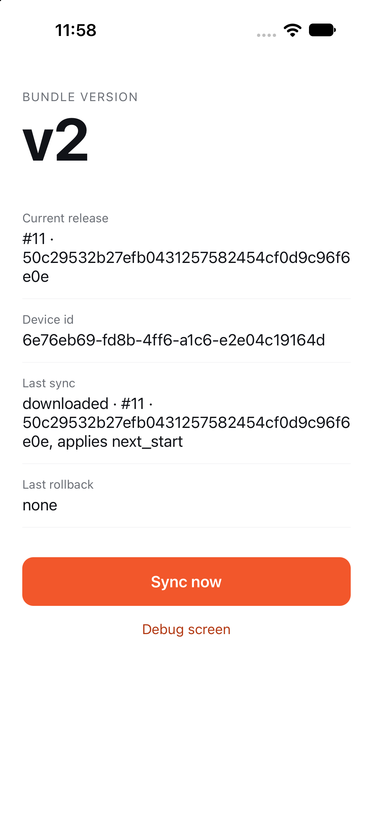

# React Native code push demo by HotCodePush

[](https://github.com/hotcodepush-team/react-native-code-push-demo/actions/workflows/ci.yml)
[](https://github.com/hotcodepush-team/react-native-code-push-demo/actions/workflows/release.yml)

A React Native app with [`@hotcodepush/react-native-code-push`](https://github.com/hotcodepush-team/react-native-code-push) wired in, the way `npx hotcodepush init` wires it. It is pre-configured for a HotCodePush app on production. Install the download, open it and watch the first over-the-air (OTA) update land. No account, no setup. Every merge to `main` ships a release to that app through the [GitHub Action](https://github.com/hotcodepush-team/release-action), and CI builds both platforms.

<p align="center">
  
</p>

## Download

The [newest release](https://github.com/hotcodepush-team/react-native-code-push-demo/releases/latest) carries the app for Android and for the iOS simulator. Every merge to `main` builds both, with the label `v1`, as a new release before it ships the update.

```sh
# Android, on a device or an emulator
adb install hotcodepush-demo-react-native-android.apk

# iOS simulator, booted from Xcode
unzip hotcodepush-demo-react-native-ios-simulator.zip
xcrun simctl install booted HotCodePushDemo.app
```

The app starts on `v1` and downloads `v2` on its first sync, the release `main` shipped after the build. Open it again and the badge reads `v2`.

## What you will see

- 🏷️ **A version badge** that changes without a store build, `v1` from the embedded bundle, then the label of the newest release.
- 🔄 **Sync now**, one call to `sync()`, with the last result and the last rollback on screen.
- 🛟 **Automatic rollback**: a release whose bundle never renders is rolled back on the next start, and the screen says so.
- 🔍 **The debug screen**, the SDK's own view of the device, the channel and the last check, one tap away.
- 🚀 **The release workflow**, `.github/workflows/release.yml`, the GitHub Action releasing once per platform on every merge.

## Tech stack

React Native 0.82 on the New Architecture, TypeScript, Hermes, the HotCodePush React Native SDK, Maestro for the device flows.

## Getting started

### Prerequisites

Node 24, as `.nvmrc` names it, Xcode or Android Studio, and CocoaPods for the iOS build. A HotCodePush account is not needed to run the demo.

### Run it

```sh
nvm use
npm ci
cd ios && pod install && cd ..
npx react-native run-ios --mode Release
```

Or `npx react-native run-android --mode release`. OTA updates are off in a debug build, where Metro serves the JavaScript, so run a release build. The app starts on its embedded bundle and syncs against the `production` channel of the demo's app. A build takes only releases created after it was built, so a fresh build answers `skipped · release_older_than_binary` until the next merge to `main` ships a release. That is what the download is for.

### Ship an update of your own

Point the demo at an app of yours and release from your machine:

```sh
npx hotcodepush init
npx hotcodepush release create --platform ios
npx hotcodepush release create --platform android
```

`init` signs you in and rewrites `hotcodepush.json` with your app. Change `VERSION` in `App.tsx` before the release, rebuild once so the store build registers itself, then reopen the app to see the new label.

## Continuous integration

`release.yml` runs on every merge to `main` and releases the change to the demo's app, once per platform:

```yaml
- uses: hotcodepush-team/release-action@v0.3.0
  with:
    token: ${{ secrets.HOTCODEPUSH_TOKEN }}
    platform: ios
    bundle-version: ${{ github.sha }}
```

`ci.yml` builds a release of the app on both platforms with the SDK the repo pins and runs the Maestro flows in `maestro/` on the simulator and the emulator.

## Development

```sh
npm start           # Metro, for a debug build
npm run lint && npm run typecheck
npm run fmt         # run before every commit
```

`CLAUDE.md` holds the native build commands, the wiring `init` adds, the Maestro flows and the environment variables that point a build at a local stack.

## Documentation

See [hotcodepush.com/docs/sdks/react-native](https://hotcodepush.com/docs/sdks/react-native).

## License

See [LICENSE](./LICENSE).
